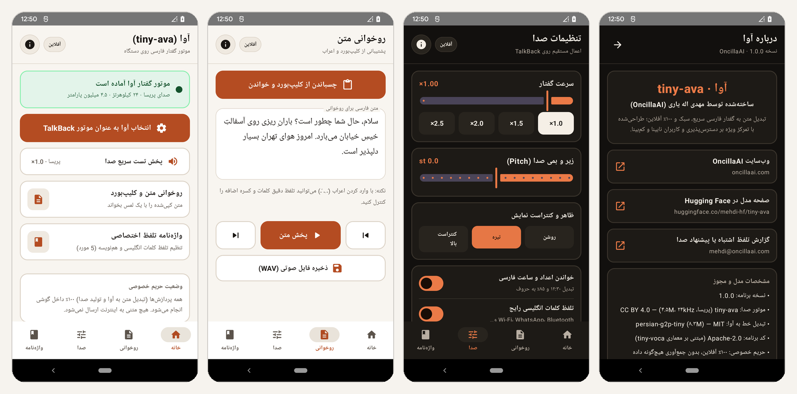

# tiny-ava

<p>
  <a href="https://buymeacoffee.com/mehdiyari"></a>
</p>

An **8.2M-parameter (`34.4 MB` ONNX)** bilingual **Persian (Farsi) + English** text-to-speech model trained **from scratch**, built on top of [`tiny-voca`](https://github.com/n4ze3m/tiny-voca). It packs **3 voices in ONE model** — **Parisa** (Persian female), **Mana** (real studio human Persian male), and **Maya** (American English female) — running **34×–81× faster than real time on CPU**, 100% offline in the browser or on Android.

- **Live in-browser demo (3 voices, FA + EN):** https://huggingface.co/spaces/mehdi-hf/tiny-ava-demo
- **Android App (Offline Bilingual TalkBack TTS):** [Download `tiny-ava-v2.0.0-arm64.apk` (71 MB)](https://github.com/mallahyari/tiny-ava/releases/latest/download/tiny-ava-v2.0.0-arm64.apk) · [All Releases](https://github.com/mallahyari/tiny-ava/releases)
- **Hugging Face model:** https://huggingface.co/mehdi-hf/tiny-ava


---

## Android App (100% Offline Bilingual Persian + English TalkBack Engine)




The [`android-app/`](android-app/) app bundles our unified **`tiny-ava-v2.onnx`** (`34.4 MB`, 3 voices) + polished **`persian-g2p-tiny`** (`8.4 MB` int8, `27/27` `ژ`, `86.4%` diacritics) + English lexicon (`3.3 MB`) inside a native Kotlin + Jetpack Compose + ONNX Runtime APK designed for **blind and low-vision Persian users**:

- **3 Voices in ONE Unified Model:** Choose between **پریسا (Parisa, female)** and **مانا (Mana, real studio human male)** for Persian, while English spans speak automatically with **مایا (Maya, American English)** — 7 MB smaller than v1.1!
- **System-wide Dual-Language Android `TextToSpeechService` (`fa-IR` + `en-US`):** Plugs directly into **TalkBack**, WhatsApp, Telegram, X, and Chrome — 100% offline with clean emoji/symbol stripping.
- **Glitch-Free High Speed up to `3.5×` (Sonic WSOLA):** Caps neural speed at `1.30×` and applies pitch-preserving Sonic WSOLA waveform time-stretching for `1.30× → 3.5×` (`1.0× / 1.5× / 2.0× / 2.5× / 3.0×` TalkBack presets).
- **Accessibility-first RTL Persian UI:** Warm Light, Dark, and **WCAG AAA High-Contrast (Yellow/Black)** themes, large 56–64dp touch targets, 1-tap **Clipboard Paste & Read**, Android **Share Intent** (*«خواندن با آوا»*), Save WAV, and an editable **Custom Pronunciation Dictionary** (`Wi-Fi ← وای‌فای`, `تست ← تُست`, etc.).
- **Built-in Persian TalkBack Normalizer:** Converts numbers, clock times (`۱۴:۳۰`), percentages (`۸۵٪`), and common English UI words automatically, plus a 256-phrase LRU RAM cache for `<5 ms` repeated menu buttons.

### Install on Android
1. Download **[`tiny-ava-v2.0.0-arm64.apk`](https://github.com/mallahyari/tiny-ava/releases/latest/download/tiny-ava-v2.0.0-arm64.apk)** (71 MB — recommended for almost all modern Android phones; use `universal` only for older 32-bit devices) and tap to install.
2. Open **آوا (tiny-ava)** → pick **پریسا** or **مانا** in the **صدا** tab → tap **«انتخاب آوا به عنوان موتور TalkBack»** (or go to **Settings → Accessibility → Text-to-speech output → Preferred engine → آوا**).
3. Tap **Listen to an example** or enable **TalkBack** — works completely offline!

### Build From Source
```bash
cd android-app
./gradlew testDebugUnitTest assembleDebug
```

---

## Quickstart: Run the Browser Demo Locally

No build step, no Node.js, no PyTorch, and no GPU needed — just Python 3's standard library:

```bash
git clone https://github.com/mallahyari/tiny-ava.git
cd tiny-ava
python3 demo/serve_local.py
```

Then open **`http://127.0.0.1:8788`** in Chrome, Safari, Firefox, or Edge:
1. Click **Download models (~46 MB)** (or click **Speak** directly) — cached locally in `CacheStorage` for instant offline use on every return visit.
2. Pick **Parisa**, **Mana**, or **Maya** and type Persian, English, or mixed sentences (optional diacritics `ـَ`, `ـِ`, `ـُ` override Persian vowels & ezafe).

### Hosting on Your Own Website or a Static HF Space

The `demo/` directory is a self-contained static site (`index.html`, `worker.js`, and `assets/`). Copy `demo/` onto any static host (Cloudflare Pages, Vercel, Netlify, GitHub Pages, or a Hugging Face Static Space) — no backend required.

---

## Models Included

| Model | File | Voices | Languages | Size | Params | CPU Speed (1t / 4t) |
| :--- | :--- | :--- | :--- | ---: | ---: | ---: |
| **`tiny-ava v2`** *(Recommended)* | `models/v2/tiny-ava-v2.onnx` / `.pt` | **Parisa** (FA), **Mana** (real human FA), **Maya** (EN) | **FA + EN** | **34.4 MB** / 31.3 MB | **8.20M** | **34.1× / 81.2× RT** |
| `tiny-ava v1` | `models/parisa/tiny-ava-parisa.onnx` / `.pt` | Parisa (FA) | FA | 20.4 MB / 18.2 MB | 4.53M | 41.9× / 83.3× RT |
| `persian-g2p-tiny` (ONNX int8) | `demo/assets/g2p/g2p_{encoder,decoder}.onnx` | — | FA | 8.4 MB | 8.26M | ~60 ms / sentence |

## Benchmarks (`tiny-ava v2`, Held-Out Test Clips, `faster-whisper large-v3`)

| Voice | Language | Data Source | **v2 CER ↓** | Ref CER | **v2 WER ↓** | Ref WER |
| :--- | :---: | :--- | ---: | ---: | ---: | ---: |
| **`mana`** *(id 2)* | Persian (`fa`) | **Real studio human** (Mana-TTS HIGH, CC0) | **5.79%** | 8.13% | **32.28%** | 40.94% |
| **`parisa`** *(id 0)* | Persian (`fa`) | Chatterbox Run C (incl. 1,494 `ژ` phones) | **7.48%** | 9.33% | **40.14%** | 44.66% |
| **`maya`** *(id 3)* | English (`en`) | `n4ze3m/tiny-voca` (CC BY 4.0) | **2.78%** | 1.72% | **10.58%** | 7.94% |

## Samples

24 kHz WAV samples for **Parisa**, **Mana**, **Maya**, and **code-switched FA+EN** are included in [`samples/v2/`](samples/v2/) (and v1 Parisa samples in [`samples/`](samples/)).

## Credits & License

- **Model Weights License:** **CC BY 4.0** — free for personal, research, and commercial use with attribution (*"Powered by tiny-ava (Mehdi Allahyari / OncillaAI)"* + link to [`mehdi-hf/tiny-ava`](https://huggingface.co/mehdi-hf/tiny-ava)).
- **Code License:** Apache-2.0 (see [`LICENSE`](LICENSE)).
- **Architecture & Data Credits:** Built on [`n4ze3m/tiny-voca`](https://github.com/n4ze3m/tiny-voca) (Apache-2.0, English voice data CC BY 4.0), [`MahtaFetrat/Mana-TTS`](https://huggingface.co/datasets/MahtaFetrat/Mana-TTS) (CC0-1.0), and [`mehdi-hf/persian-g2p-tiny`](https://huggingface.co/mehdi-hf/persian-g2p-tiny) (MIT).
