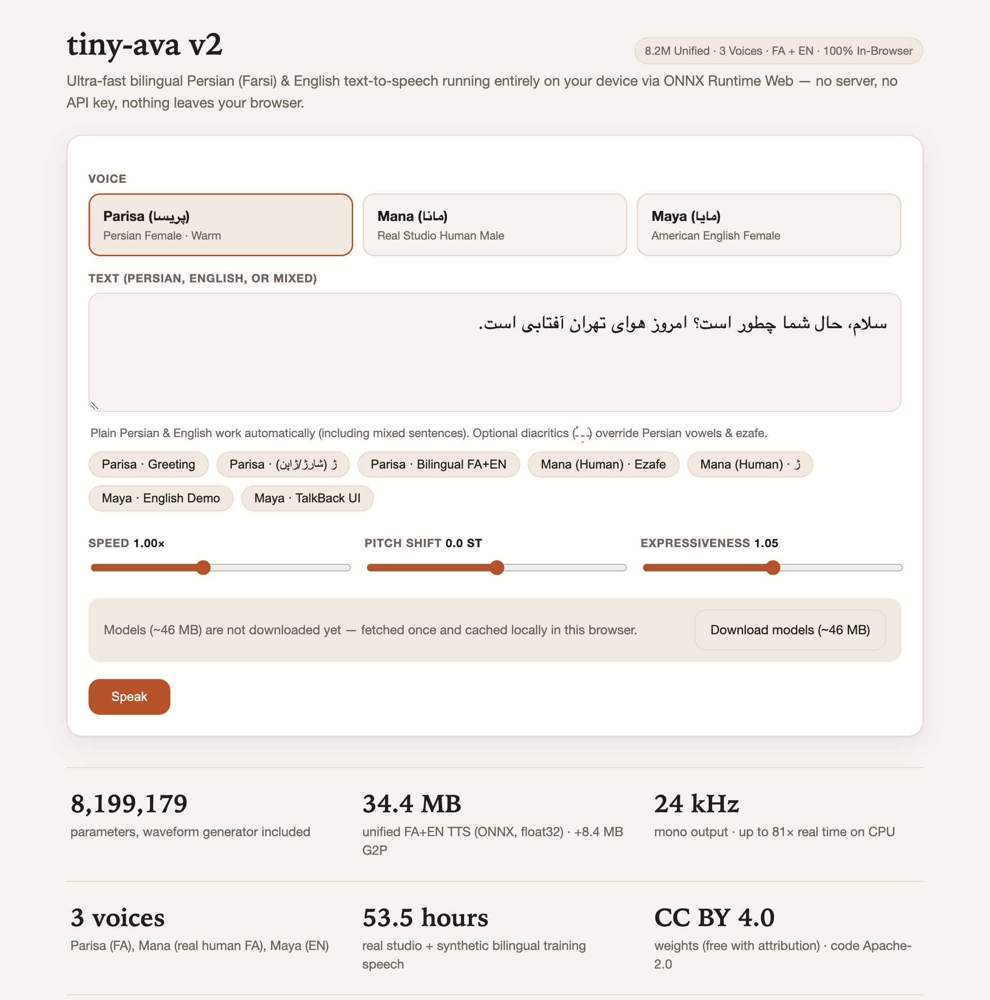
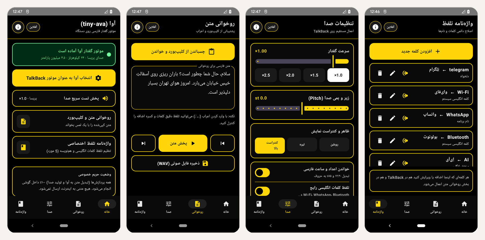

# tiny-ava

A **4.5M-parameter (~18 MB PyTorch / ~20 MB ONNX)** Persian (Farsi) text-to-speech model trained **from scratch** on ~20 hours of synthetic speech, built on top of [`tiny-voca`](https://github.com/n4ze3m/tiny-voca). It runs **38×–77× faster than real time on CPU** and **100% client-side in your browser** via ONNX Runtime Web (~29 MB total including Persian G2P).

- **Live in-browser demo:** https://huggingface.co/spaces/mehdi-hf/tiny-ava-demo
- **Android App (Offline Bilingual TalkBack TTS):** [Download `tiny-ava-v1.1.0-arm64.apk` (78 MB)](https://github.com/mallahyari/tiny-ava/releases/latest/download/tiny-ava-v1.1.0-arm64.apk) · [All Releases](https://github.com/mallahyari/tiny-ava/releases)
- **Hugging Face model:** https://huggingface.co/mehdi-hf/tiny-ava



---

## Android App (100% Offline Persian TalkBack Engine)




The [`android-app/`](android-app/) app packages `tiny-ava` (`20.4 MB`) + `persian-g2p-tiny` (`8.4 MB`) inside a native Kotlin + Jetpack Compose + ONNX Runtime Android APK designed for **blind and low-vision Persian users**:

- **System-wide Dual-Language Android `TextToSpeechService` (`fa-IR` + `en-US`):** Plugs directly into **TalkBack**, WhatsApp, Telegram, X, and Chrome — 100% offline. Automatically routes Persian spans to **`tiny-ava` (Parisa)** and English spans to **`tiny-voca` English (Apache-2.0)** with clean emoji/symbol stripping.
- **Glitch-Free High Speed up to `3.5×` (Sonic WSOLA):** Caps neural speed at `1.30×` and applies pitch-preserving Sonic WSOLA waveform time-stretching above `1.30×` — zero distortion at fast blind-user TalkBack speeds (`1.5× / 2.0× / 2.5× / 3.0× / 3.5×`).
- **Accessibility-first RTL Persian UI:** Warm Light, Dark, and **WCAG AAA High-Contrast (Yellow/Black)** themes, large 56–64dp touch targets, 1-tap **Clipboard Paste & Read**, Android **Share Intent** (*«خواندن با آوا»*), Save WAV, and an editable **Custom Pronunciation Dictionary** (`Wi-Fi ← وای‌فای`, `تست ← تُست`, etc.).
- **Built-in Persian TalkBack Normalizer:** Converts numbers, clock times (`۱۴:۳۰`), percentages (`۸۵٪`), and common English UI words automatically, plus a 256-phrase LRU RAM cache for `<5 ms` repeated menu buttons.

### Install on Android
1. Download **[`tiny-ava-v1.1.0-arm64.apk`](https://github.com/mallahyari/tiny-ava/releases/latest/download/tiny-ava-v1.1.0-arm64.apk)** (recommended for almost all modern phones; use `universal` only for older 32-bit devices) and tap to install.
2. Open **آوا (tiny-ava)** and tap **«انتخاب آوا به عنوان موتور TalkBack»** (or go to **Settings → Accessibility → Text-to-speech output → Preferred engine → آوا**).
3. Tap **Listen to an example** or enable **TalkBack** — works completely offline!

### Build From Source
```bash
cd android-app
./gradlew testDebugUnitTest assembleDebug
```

---

## Quickstart: Run the Browser Demo Locally

No build step, no Node.js, no PyTorch, and no GPU needed — just Python 3's standard library:

```bash
git clone https://github.com/mallahyari/tiny-ava.git
cd tiny-ava
python3 demo/serve_local.py
```

Then open **`http://127.0.0.1:8788`** in Chrome, Safari, Firefox, or Edge:
1. Click **Download models (~29 MB)** (or click **Speak** directly).
2. The first visit caches the ONNX models (`20.4 MB` TTS + `8.4 MB` int8 Persian G2P) locally in your browser's `CacheStorage`; every visit after that loads instantly and works **100% offline**.
3. Type any Persian text (plain text works automatically, and optional diacritics `ـَ`, `ـِ`, `ـُ` override vowels & ezafe — e.g. `بارانِ ریزی`, `گُل` vs `گِل`).

### Hosting on Your Own Website or a Static HF Space

The `demo/` directory is a completely self-contained static site (`index.html`, `app.js`, `worker.js`, and `assets/`). Copy the `demo/` folder directly onto any static host (Cloudflare Pages, Vercel, Netlify, GitHub Pages, or a Hugging Face Static Space) — no backend required.

---

## Quickstart: Run in Python (ONNX Runtime, No PyTorch Needed)

```bash
pip install onnxruntime numpy soundfile
```

```python
import json
import numpy as np
import onnxruntime as ort
import soundfile as sf

# 1. Load ONNX sessions (8.4 MB int8 G2P + 20.4 MB tiny-ava TTS)
enc = ort.InferenceSession("demo/assets/g2p/g2p_encoder.onnx")
dec = ort.InferenceSession("demo/assets/g2p/g2p_decoder.onnx")
tts = ort.InferenceSession("models/parisa/tiny-ava-parisa.onnx")

meta = json.load(open("models/parisa/tiny-ava-parisa.json", encoding="utf-8"))
sym2id = {s: i for i, s in enumerate(meta["symbols"])}
phone_set = set(meta["symbols"][17:])
vowels = {"a", "e", "o", "i", "u", "ɑ"}
r1_to_ipa = {
    "a": "a", "A": "ɑ", "e": "e", "o": "o", "i": "i", "u": "u",
    "p": "p", "b": "b", "t": "t", "d": "d", "k": "k", "g": "ɡ", "q": "q", "?": "ʔ",
    "f": "f", "v": "v", "s": "s", "z": "z", "S": "ʃ", "Z": "ʒ", "x": "x", "h": "h",
    "C": "tʃ", "j": "dʒ", "m": "m", "n": "n", "l": "l", "r": "r", "y": "j",
}

def persian_g2p(text: str) -> str:
    in_ids = np.array([[b + 3 for b in text.encode("utf-8")] + [1]], dtype=np.int64)
    attn = np.ones_like(in_ids, dtype=np.int64)
    (eh,) = enc.run(None, {"input_ids": in_ids, "attention_mask": attn})
    out_ids = [0]
    for _ in range(256):
        (logits,) = dec.run(None, {
            "decoder_input_ids": np.array([out_ids], dtype=np.int64),
            "encoder_hidden_states": eh,
            "encoder_attention_mask": attn,
        })
        nxt = int(logits[0, -1].argmax())
        if nxt == 1:
            break
        out_ids.append(nxt)
    return bytes(i - 3 for i in out_ids[1:] if 3 <= i <= 258).decode("utf-8", errors="ignore").strip()

def speak(text: str, out_wav: str = "hello.wav", speed: float = 1.0, pitch_shift: float = 0.0, pitch_range: float = 1.05):
    repr1 = persian_g2p(text)
    syms, stress = ["<bos>"], [0]
    for rw in repr1.split():
        if syms[-1] in phone_set:
            syms.append("<sp>"); stress.append(0)
        if rw.endswith("-ye"):
            stem, ez = rw[:-3], "ye"
        elif rw.endswith("-e"):
            stem, ez = rw[:-2], "e"
        else:
            stem, ez = rw, ""
        stem = stem.replace("-", "")
        if len(stem) >= 2 and stem[0] == "?" and stem[1] in "aAeoiu":
            stem = stem[1:]
        phs = [[r1_to_ipa[c], 0] for c in stem if c in r1_to_ipa]
        for i in range(len(phs) - 1, -1, -1):
            if phs[i][0] in vowels:
                phs[i][1] = 1
                break
        for c in ez:
            if c in r1_to_ipa:
                phs.append([r1_to_ipa[c], 2 if r1_to_ipa[c] in vowels else 0])
        for p, lvl in phs:
            syms.append(p); stress.append(lvl)
    syms.extend([".", "<eos>"]); stress.extend([0, 0])

    audio, _ = tts.run(None, {
        "tokens": np.array([[sym2id[s] for s in syms]], dtype=np.int64),
        "stress": np.array([stress], dtype=np.int64),
        "voice": np.array([0], dtype=np.int64),
        "speed": np.array([speed], dtype=np.float32),
        "pitch_shift": np.array([pitch_shift], dtype=np.float32),
        "pitch_range": np.array([pitch_range], dtype=np.float32),
    })
    wav = audio[0]
    peak = float(np.abs(wav).max())
    if peak > 0.99:
        wav = wav * (0.99 / peak)
    sf.write(out_wav, wav, 24000)

speak("سلام، حال شما چطور است؟ امروز هوای تهران آفتابی است.", "hello.wav")
```

---

## Models Included

| Voice | File | Format | Size | Parameters | Sample Rate | CPU Speed (1t / 4t) |
| :--- | :--- | :--- | ---: | ---: | ---: | ---: |
| **Parisa** | `models/parisa/inference.pt` | PyTorch | 18.2 MB | 4.53M | 24 kHz | **38.5× / 77.4× real-time** |
| **Parisa** | `models/parisa/tiny-ava-parisa.onnx` | ONNX (opset 17) | 20.4 MB | 4.53M | 24 kHz | ONNX Runtime / Web |
| **G2P (tiny)** | `demo/assets/g2p/g2p_{encoder,decoder}.onnx` | ONNX (int8) | 8.4 MB | 8.26M | — | ~60 ms / sentence |

## Benchmarks (50 Held-Out Persian Test Clips, `faster-whisper large-v3`)

| Model | Persian CER ↓ | Persian WER ↓ |
| :--- | ---: | ---: |
| **tiny-ava (Parisa, 4.53M)** | **6.95%** | **36.96%** |
| Teacher recordings (reference floor) | 8.20% | 40.22% |

## Samples

12 sample 24 kHz WAVs covering greetings, ezafe chains, explicit kasra (`ـِ`), homographs (`تست`, `گل`/`گِل`, `مرد`), Persian uvulars (`ق/غ/خ/ع`), questions, long text, and colloquial Persian are included in [`samples/`](samples/).

## Credits & License

- **Model Weights License:** **CC BY 4.0** — free for personal, research, and commercial use with attribution (*"Powered by tiny-ava (Mehdi Allahyari / OncillaAI)"* + link to `mehdi-hf/tiny-ava`).
- **Code License:** Apache-2.0 (see [`LICENSE`](LICENSE)).
- **Architecture:** Built on [`n4ze3m/tiny-voca`](https://github.com/n4ze3m/tiny-voca) (Apache-2.0) by Muhammed Nazeem.
- **Persian G2P:** [`mehdi-hf/persian-g2p-tiny`](https://huggingface.co/mehdi-hf/persian-g2p-tiny) (MIT) · `mehdi-hf/persian-g2p-0.6b` (Apache-2.0).
